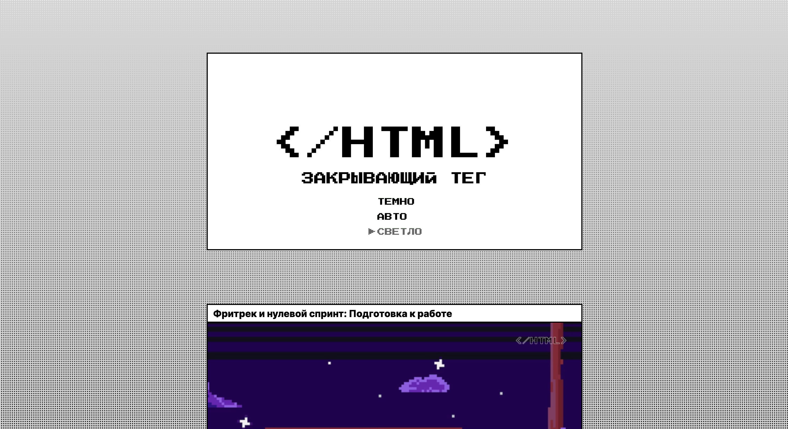
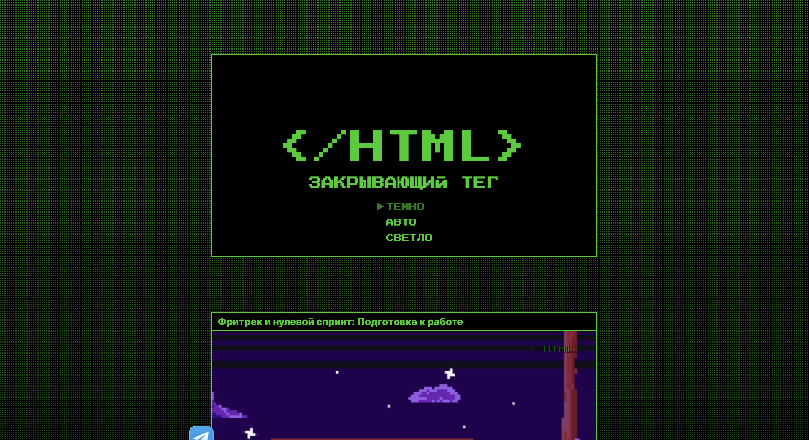
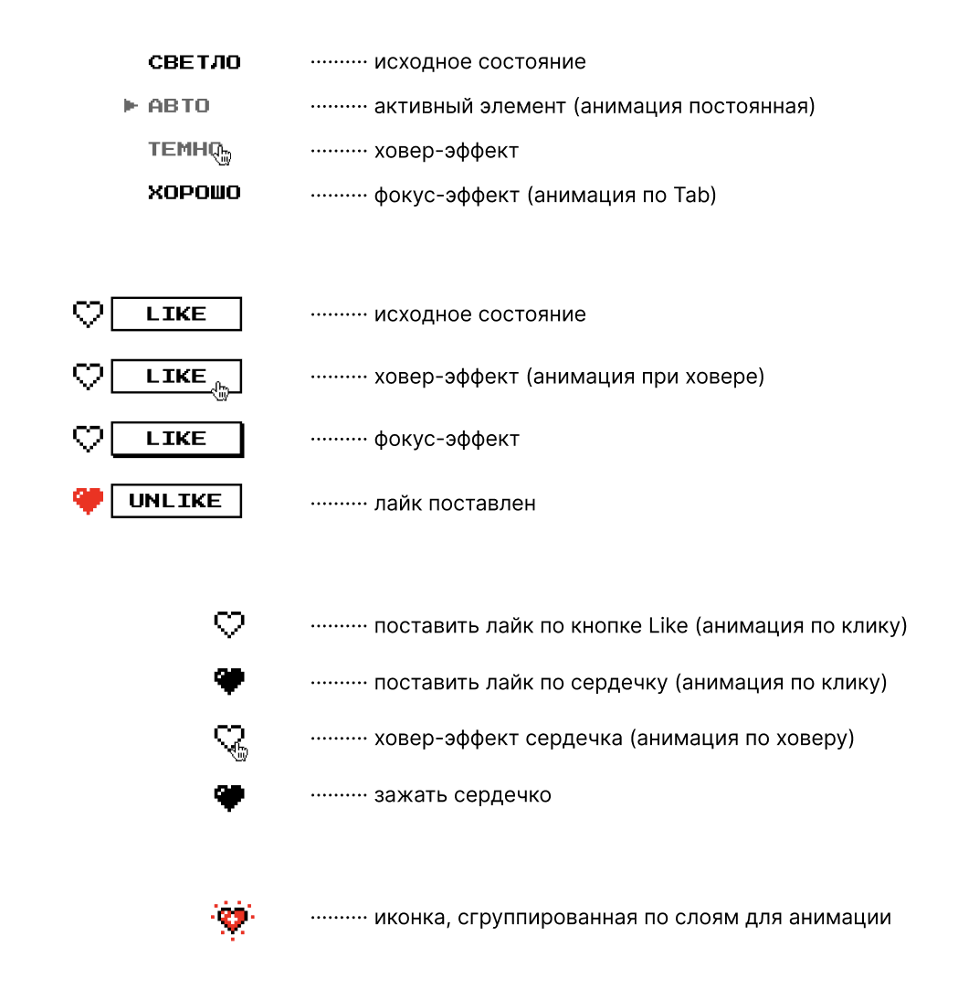
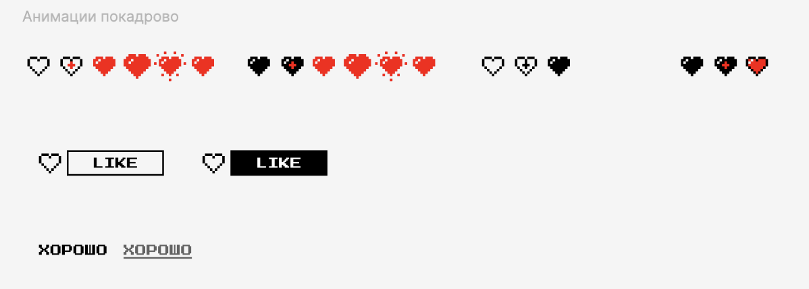

# Проект "Закрывающий тег"

### Светлая тема:



### Темная тема:



# Описание проекта

Пет-проект для отработки css-стилей и css-анимаций

## Анимации





## Запуск проекта
```
git clone https://github.com/ElizavetaSf/posmotri_v_okno
npm install
npm run start
```

### Сборка

```
npm run build
```
